<div align="center">

# Byheir Wise

**Engineering leader · Servicing & collections systems · Regulated fintech**

I design, build, and lead the systems behind lending, servicing, and collections.

[**www.byheir.com**](https://www.byheir.com) &nbsp;·&nbsp; [For hiring managers](https://www.byheir.com/pages/for-hiring-managers.html) &nbsp;·&nbsp; [Resume (PDF)](assets/byheir-wise-resume.pdf) &nbsp;·&nbsp; [LinkedIn](https://www.linkedin.com/in/byheir-wise-976253265)

<br>

<a href="https://www.byheir.com">
  <picture>
    <source media="(prefers-color-scheme: light)" srcset="assets/readme/home-light.jpg">
    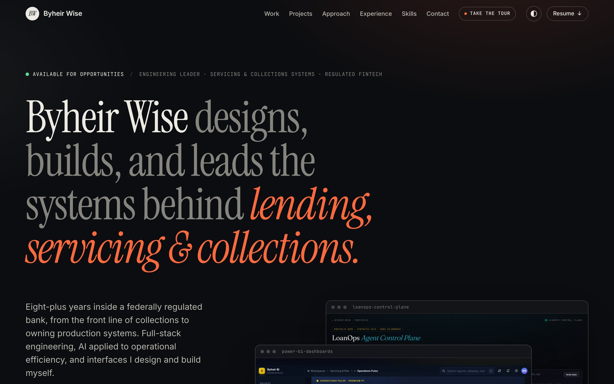
  </picture>
</a>

</div>

<br>

This is the source for my portfolio. Every interface in it — 76 pages across case studies, live demos, and five domain suites — was designed and coded by me. Static HTML, CSS, and vanilla JavaScript on GitHub Pages. No framework, no build step.

> **Reviewing for a role?** Start with [`pages/for-hiring-managers.html`](https://www.byheir.com/pages/for-hiring-managers.html). Every resume bullet is mapped to the page or live site that proves it, plus impact numbers with methodology.

---

## Live in production

<table>
  <tr>
    <td width="55%"><a href="https://www.wiseforge.dev">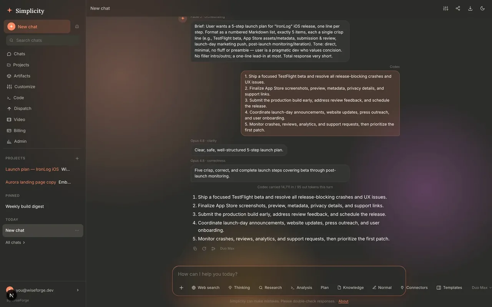</a></td>
    <td width="15%"><a href="https://ironlog.space">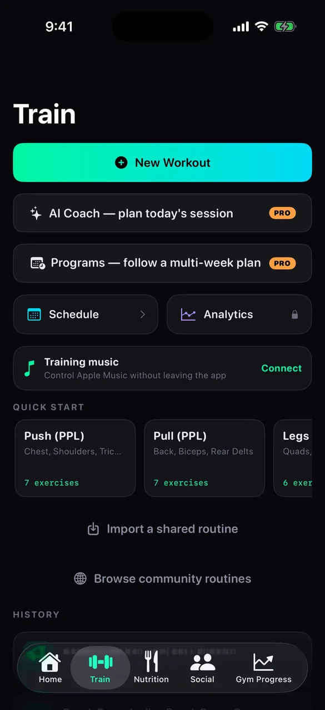</a></td>
    <td width="15%"><a href="https://ironlog.space">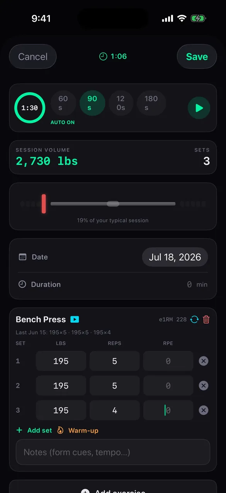</a></td>
    <td width="15%"><a href="https://ironlog.space">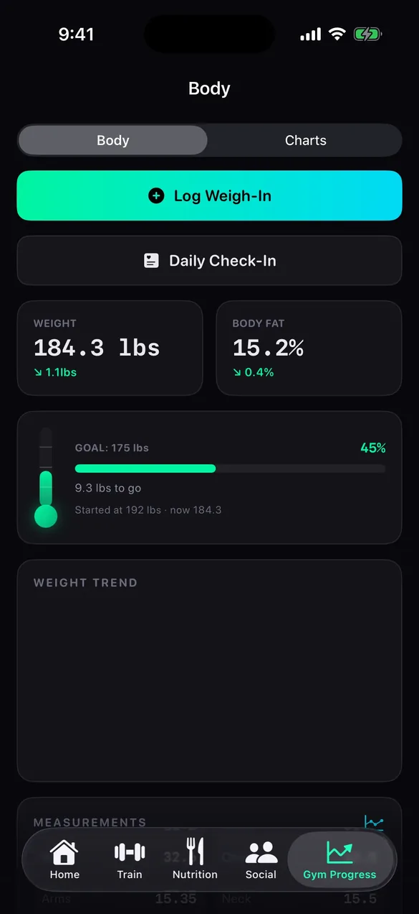</a></td>
  </tr>
  <tr>
    <td><b>Simplicity by WiseForge</b> · <a href="https://www.wiseforge.dev">wiseforge.dev</a><br><sub>Production Claude-powered AI product shipped solo · streaming APIs, OAuth 2.0 + PKCE, multi-provider routing, Stripe</sub></td>
    <td colspan="3"><b>IronLog</b> · <a href="https://ironlog.space">ironlog.space</a><br><sub>Analytics PWA suite on one Supabase backend · SSO, real-time sync · sole designer + engineer</sub></td>
  </tr>
  <tr>
    <td><a href="https://partnerpulse.byheir.com">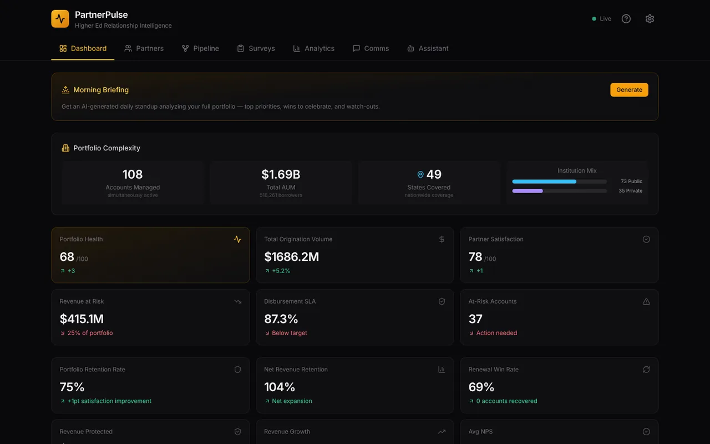</a></td>
    <td><a href="https://partnerpulse.byheir.com">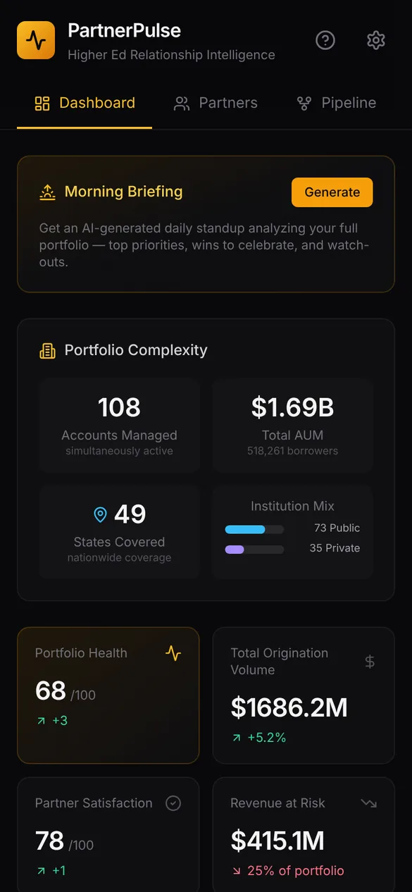</a></td>
    <td colspan="2"><b>PartnerPulse</b> · <a href="https://partnerpulse.byheir.com">partnerpulse.byheir.com</a><br><sub>Partner relationship analytics PWA · portfolio health scoring, KPI dashboards, AI-generated executive comms</sub></td>
  </tr>
</table>

## Selected interfaces

Real screenshots of pages in this repo — not mockups.

<table>
  <tr>
    <td width="50%"><a href="https://www.byheir.com/pages/loanops-control-plane.html">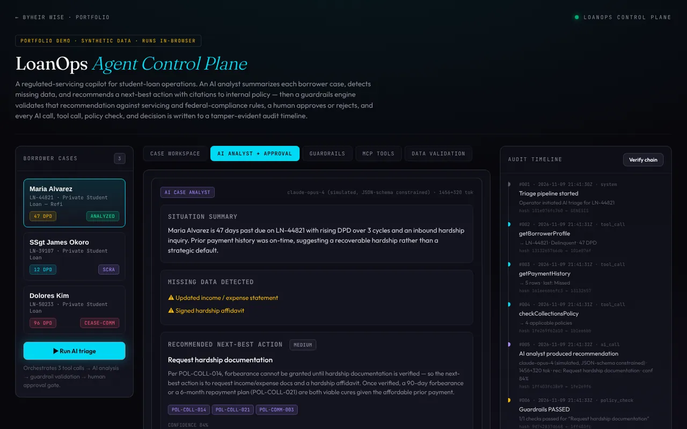</a><br><b>LoanOps Agent Control Plane</b><br><sub>Regulated-servicing AI copilot · guardrails, audit trail, human approval</sub></td>
    <td width="50%"><a href="https://www.byheir.com/pages/power-bi-dashboards.html">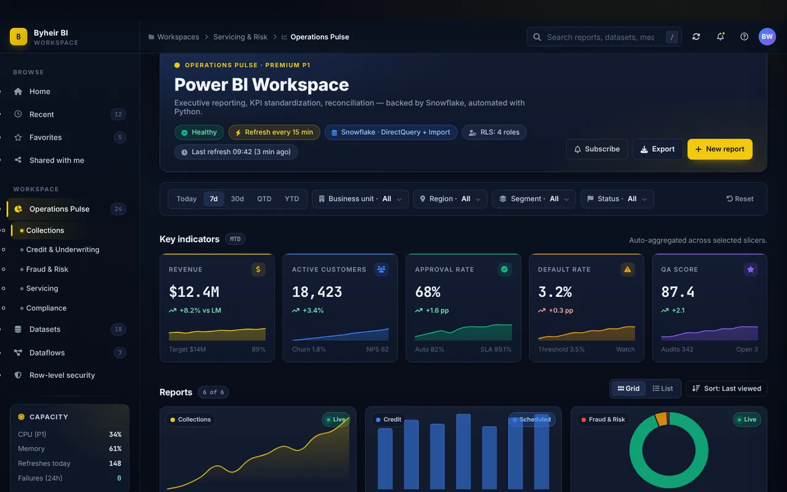</a><br><b>Power BI Dashboards</b><br><sub>Executive reporting · KPI standardization · reconciliation</sub></td>
  </tr>
  <tr>
    <td><a href="https://www.byheir.com/pages/sql-playground.html">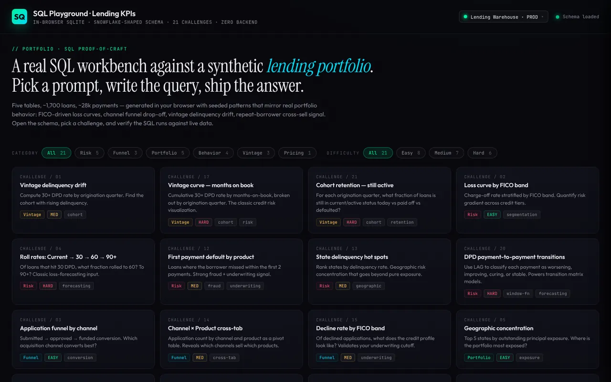</a><br><b>SQL Playground</b><br><sub>Real SQL in the browser · SQLite WASM · 21 lending challenges</sub></td>
    <td><a href="https://www.byheir.com/pages/refi-intelligence.html">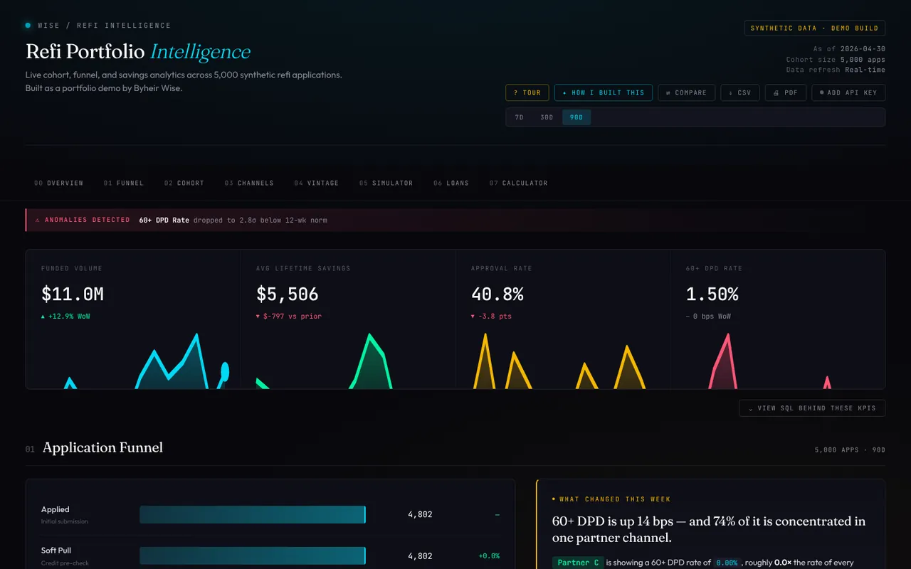</a><br><b>Refi Intelligence</b><br><sub>Cohort heatmaps, funnel drop-off, savings distribution · React + Recharts</sub></td>
  </tr>
  <tr>
    <td><a href="https://www.byheir.com/pages/dashboard.html">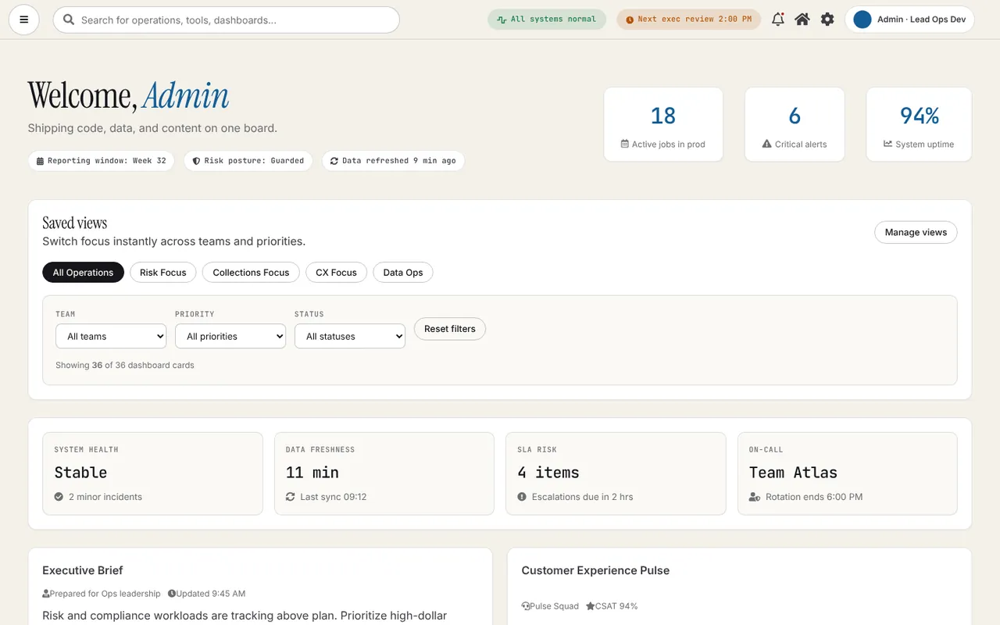</a><br><b>Operations Dashboard</b><br><sub>Command-center hub · SLA risk, alerts, workload</sub></td>
    <td><a href="https://www.byheir.com/pages/credit-underwriting.html">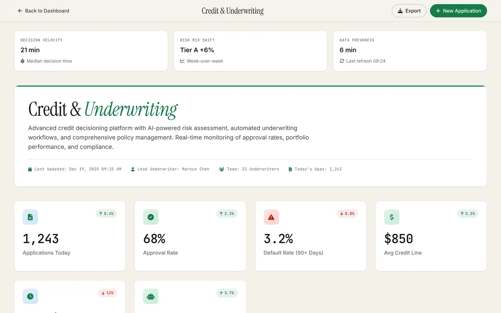</a><br><b>Credit Underwriting</b><br><sub>Decision engine, manual review, adverse action · 11 screens</sub></td>
  </tr>
</table>

<table>
  <tr>
    <td width="22%"><a href="https://www.byheir.com/pages/banking.html">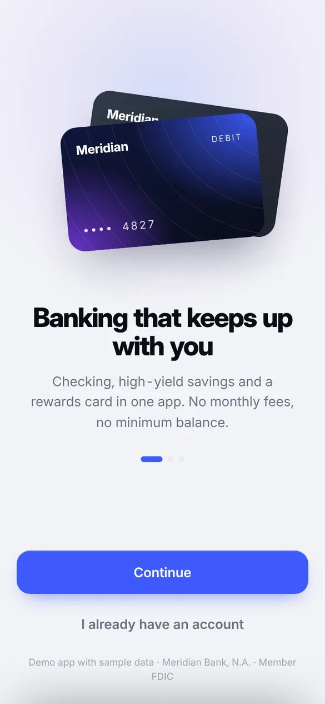</a></td>
    <td width="22%"><a href="https://www.byheir.com/pages/banking.html">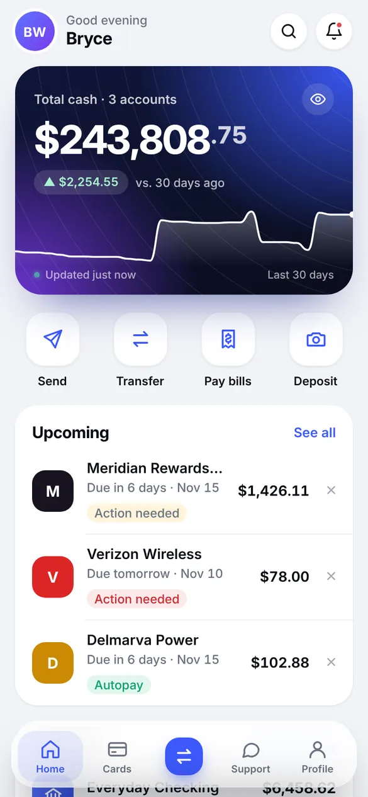</a></td>
    <td width="22%"><a href="https://www.byheir.com/pages/banking.html">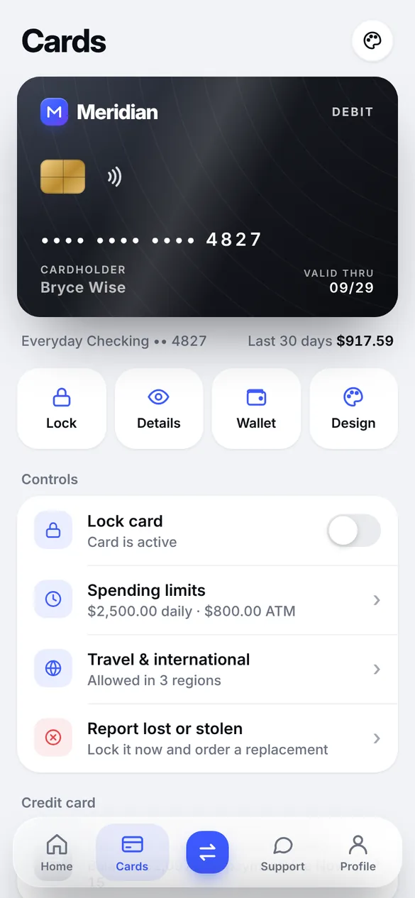</a></td>
    <td><b>Meridian Banking PWA</b><br><br><sub>Installable mobile banking: passcode + passkey (WebAuthn) sign-in, transfers, bill pay and wires with step-up auth, card lock and limits, statements, spending insights. Offline-capable, and the sample data reconciles to the cent.</sub></td>
  </tr>
</table>

---

## How it's designed

The homepage is the design sample. It runs on one small token set and nothing else.

| | |
|---|---|
| **Type** | Instrument Serif for display, Inter for reading, JetBrains Mono for labels and data. A fluid scale (`--step-0` → `--step-5`) so headings resize without breakpoints. |
| **Color** | Six roles — ground, surface, rule, muted, ink, signal — defined once per theme. Dark is the default; a light "paper" theme is one attribute away (`data-theme`). |
| **Layout** | A 12-column editorial grid with hairline rules instead of boxes. Screenshots sit in a single reusable browser or phone frame. |
| **Motion** | Short, eased reveals and a few pixels of parallax. All of it is switched off under `prefers-reduced-motion`. |
| **Access** | Semantic landmarks, skip link, visible focus, keyboard-operable nav and filters, AA text contrast in both themes. The page reads top to bottom with JavaScript off. |

The principles behind the interface work, each with the page that shows it:

1. **Hierarchy before decoration** — every screen starts from the decision it supports. → [`pages/case-study.html`](pages/case-study.html)
2. **Systems, not screens** — five domain suites and 49 screens on one set of patterns. → [`pages/dashboard.html`](pages/dashboard.html)
3. **Designed in the medium** — prototyped in code, with real states and real data. → [`pages/sql-playground.html`](pages/sql-playground.html)
4. **Trust is a design material** — audit trails, policy citations, and human approval are part of the UI. → [`pages/loanops-control-plane.html`](pages/loanops-control-plane.html)

---

## Quickstart

```bash
# Clone and serve locally — no install, no build
git clone https://github.com/wisemanmax/Bwise.git
cd Bwise
python3 -m http.server 8000
# → http://localhost:8000
```

Or just open `index.html` directly in a browser.

The only tooling is a test suite for the Snowsight SQL engine demo (`npm install && npm test`), which CI runs on every pull request.

---

## Repo structure

```
.
├── index.html              # Homepage — hero, work gallery, projects, approach, experience, skills, contact
├── pages/                  # 76 sub-pages: case studies, live demos, domain suites
├── assets/
│   ├── home.css            # Homepage design system (tokens, both themes, components)
│   ├── home.js             # Homepage interactions (theme, filters, reveals) — progressive enhancement
│   ├── style.css           # Shared styles for the sub-pages
│   ├── suite.css           # One skin for the five domain suites (accent per suite via data-suite)
│   ├── suite.js            # Suite behaviour (paged tables, collapsed card grids)
│   ├── education.js        # Education pages: sample records, summary, filters, paged ledger
│   ├── dashboard.css       # Skin for the Operations and Education dashboards (light + dark)
│   ├── script.js           # Shared behaviour (mobile nav, guided tour, demos)
│   ├── tour.css            # Guided-tour UI, shared by the homepage and sub-pages
│   ├── work/               # Screenshots of the live pages, used by the gallery
│   ├── readme/             # Images for this README
│   ├── data/               # JSON fixtures for demos (dashboard, learning library)
│   └── byheir-wise-resume.pdf
├── mock-exports/           # Sample report exports (PNG/SVG) for BI showcases
├── CNAME                   # GitHub Pages → www.byheir.com
└── manifest.webmanifest    # PWA manifest
```

---

## Evidence index

Where to look when you want proof of a specific claim.

### Case studies (decisions + tradeoffs, not just screenshots)
| Project | What it shows | File |
|---|---|---|
| Cowork (autonomous software pipeline) | 16 specialized agents · 5 parallel lanes · auto-gate · self-healing · live dashboard | `pages/cowork.html` |
| Operations Command Center | Cross-functional ops platform — KPI design, alert/workflow architecture | `pages/case-study.html` |
| The Builder | AI-augmented reporting & validation — multi-stage pipelines, audit trails | `pages/the-builder.html` |
| SQL Playground · Lending KPIs | In-browser SQLite (WASM), Snowflake-shaped lending schema, 21 challenges | `pages/sql-playground-case-study.html` |
| Power BI Dashboards | Executive reporting, KPI standardization, reconciliation patterns | `pages/power-bi-dashboards.html` |

### Domain suites (UI explorations across regulated-fintech workflows)
| Domain | Entry point | Coverage |
|---|---|---|
| Collections | `pages/collections-toolkit.html` | Segmentation, dialer, comms hub, QA, compliance, skip-trace, agency mgmt |
| Fraud Risk | `pages/fraud-risk.html` | Real-time monitoring, alert triage, link analysis, ID verification, investigations |
| Credit Underwriting | `pages/credit-underwriting.html` | Decision engine, doc processing, manual review, adverse action, scoring |
| Servicing CX | `pages/servicing-cexp.html` | Account mgmt, loss mitigation, support portal, comms hub, surveys |
| Education | `pages/education-overview.html` | Cohorts, content studio, modules, quizzes, tests, library |

### Live demos (functional, not mockups)
| Demo | What runs | File |
|---|---|---|
| LoanOps Agent Control Plane | Regulated-servicing AI copilot — explainable analyst w/ policy citations, guardrails engine, MCP-style tool connectors, tamper-evident (hash-chained) audit timeline, human approval flow, Snowflake-style validation layer | `pages/loanops-control-plane.html` |
| Operations Dashboard | SLA risk, alerts, workload — links the suites above | `pages/dashboard.html` |
| Refi Intelligence | Cohort heatmaps, funnel drop-off, savings dist. across 5,000 synthetic apps | `pages/refi-intelligence.html` |
| SQL Playground | Real SQL against a synthetic lending portfolio in-browser | `pages/sql-playground.html` |
| Meridian Banking PWA | Mobile banking app — passcode + passkey (WebAuthn) sign-in, transfers / Zelle® / bill pay / wires with step-up auth, card lock & limits, statements, spending insights, offline-capable service worker. Sample data is generated relative to today and reconciles to the cent | `pages/banking.html` (+ `banking.css`, `banking.js`) |

### External projects (live in production, separate repos)
| Project | Stack | Live | Evidence in this repo |
|---|---|---|---|
| Cowork Dashboard | Node.js, Express, vanilla JS, Tailwind, Cloudflare Tunnel, launchd | [automation.byheir.com](https://automation.byheir.com) | `pages/cowork.html` |
| IronLog Analytics Ecosystem | React 18, Vite, Supabase, Vercel, Cloudflare R2, PWA | [ironlog.space](https://ironlog.space) | `pages/ironlog.html` |
| PartnerPulse | React 18, Vite, Recharts, Cloudflare Workers, Claude Sonnet | [partnerpulse.byheir.com](https://partnerpulse.byheir.com) | — |

### Engineering practice pages
| Topic | File |
|---|---|
| HTML / CSS / JS examples | `pages/html.html`, `pages/css.html`, `pages/javascript.html` |
| CI/CD discipline | `pages/cicd.html` |
| Backend / mock APIs | `pages/backend.html`, `pages/mock-api.html` |
| Compliance matrix | `pages/compliance-matrix.html` |
| AI search | `pages/ai-search.html` |

### For reviewers
| Page | What it does | File |
|---|---|---|
| For hiring managers | Resume claim → repo evidence map; impact numbers with methodology | `pages/for-hiring-managers.html` |

---

## Resume bullet → repo evidence

| Resume claim | Where to verify |
|---|---|
| Power BI / Snowflake reporting across collections, fraud, compliance, servicing | Domain suites (above) + `pages/power-bi-dashboards.html` |
| Reduced manual reporting effort by 60% via Python automation | `pages/the-builder.html` (validation/release flow) |
| AI-augmented testing platform across six categories | `pages/the-builder.html`, `pages/ai-search.html` |
| Full-stack work in Python / TypeScript / React | `pages/ironlog.html` (IronLog evidence), PartnerPulse, `pages/refi-intelligence.html` |
| IaC & CI/CD discipline for analytics tooling | `pages/cicd.html` |
| Adoption / training / KPI standardization | `pages/case-study.html` (Operations Command Center) |

---

---

## Tech

Static HTML, CSS, and vanilla JavaScript. No framework, no build step, no runtime dependencies on the homepage beyond three web fonts (Instrument Serif, Inter, JetBrains Mono) with a system-stack fallback. Individual demos pull what they need from a CDN — React, Recharts, Chart.js, sql.js, CodeMirror. Hosted on GitHub Pages.

External projects linked from the work section use React 18 + Vite + Supabase / Cloudflare Workers (separate repos).

---

## Contact

- Site: [www.byheir.com](https://www.byheir.com)
- Email: [byheirw@gmail.com](mailto:byheirw@gmail.com)
- LinkedIn: [byheir-wise](https://www.linkedin.com/in/byheir-wise-976253265)
